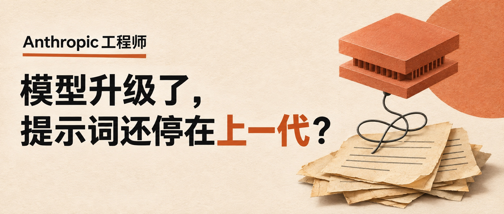

# 编辑插画封面案例：新模型与旧提示词

适用于已确认标题和正文、用户请求封面，且文章的核心关系适合视觉化的情况。封面流程与验收以 [封面指南](../cover-art-guide.md) 为准；本文件记录一次得到用户肯定的设计选择，不设通用配色或构图硬指标。

## 已验证案例

2026-11-10，文章标题确定为「Anthropic 工程师：模型升级了，提示词还停在上一代？」后，用户请求封面。生成并查看成图后，用户反馈「这次配图不错」，并要求沉淀到技能。



这次采用米白纸张底、黑色粗标题、陶土橙强调词与主体。左侧约三分之二放标题，右侧以现代计算核心、旧纸张和连接线表达新模型仍连接旧指令的关系。插画是概念比喻，不是实际硬件、界面或实验图。没有生成讲者肖像、官方标识或额外收益数字。

封面把真实人物身份「Anthropic 工程师」作为较小的引题；正文标题的问题分成两行，保留问号，给「上一代」少量颜色强调。用户确认的是整张成图，不能据此断言纸张纹理、橙色或某个比例单独造成了好评，也不能推广成每篇文章都用芯片和旧纸张。

## 可迁移的设计思路

- 从正文挑一个可以看懂的关系，再选择对应物体。插画应帮助理解主题；不要只因是 AI 文章就加机器人、发光大脑或代码雨。
- 让标题承担信息，插画承担关系。信息层次可以是「短引题＋大标题＋一个主体关系」，不必把摘要和多个论点塞进封面。
- 用少量颜色建立层级；留白、字重和插画细节服务手机阅读。配色、材质和左右布局随题材与品牌要求调整。
- 明确告诉生成工具哪些文字必须原样出现、在哪里换行、哪些词要强调。除指定文案外，不让工具自行添加引语、期号、身份或数据。
- 用户给出配色、照片、比例或品牌规范时，以其要求为准。精确字形难以一次生成时，可保留插画并改用可控排版，不无限重复抽图。

## 本案例的实际生成提示词

使用内置图像生成工具，一次生成。以下是当时实际提示词，作为具体示例；复用时替换文章主题、文案和视觉关系，不能只改标题后沿用不相干的插画。

```text
Use case: ads-marketing. Create one finished Chinese WeChat article cover, very wide 2.35:1 aspect ratio (2350 by 1000 composition). Elegant editorial magazine design, warm ivory paper with subtle print grain, near-black typography and a restrained terracotta orange accent. Extremely clear professional Chinese typography, no garbled characters. Exact text: small but readable kicker 'Anthropic 工程师' above the headline; headline on two lines '模型升级了，' and '提示词还停在上一代？'. The question mark is essential. No other text, no footer, no logo, no watermark, no invented person portrait. Left two thirds are clean generous negative space with the two-line headline in bold Chinese sans-serif, large and easy to read on mobile; '上一代' in terracotta orange, rest black. Right third has a sophisticated tactile paper-collage editorial illustration: a sleek modern terracotta geometric computing core hovering slightly above a stack of yellowed old instruction sheets, with a loose black tangled cable linking them; simple printed lines on the sheets, no legible extra words. This is a conceptual visual metaphor about upgraded AI models still using outdated instructions, not an actual product screenshot. Calm, intelligent, understated, balanced asymmetrical composition; no neon, no generic sci-fi robot, no glowing brain. Keep all lettering inside comfortable safe margins, use crisp shapes and restrained soft shadows, art-directed print quality. The final image should be ready to publish as a single wide cover.
```

## 成图与交付记录

实际输出为 1921×819，约 2.35:1；提示词中的构图尺寸不是文件尺寸保证。原始 PNG 留存，另转换为 JPEG，未裁切或修改画面。配套保存生成提示词及素材清单，标题、出处身份和问号逐字核对。完整标题不适合直接居中方形裁切；当次仅请求宽幅，未额外生成方版。

示例图由 AI 生成，作为本技能的视觉参考随仓库保存。图中文字来自用户确认的文章标题；它不表示 Anthropic 官方设计或背书。新任务的原图、元数据与提示词仍放在各自任务目录，不放入技能安装目录。
